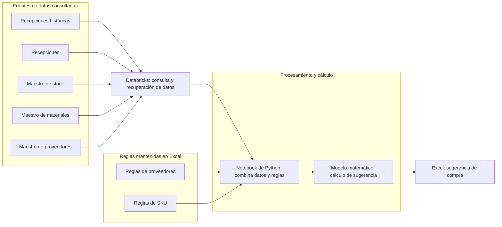
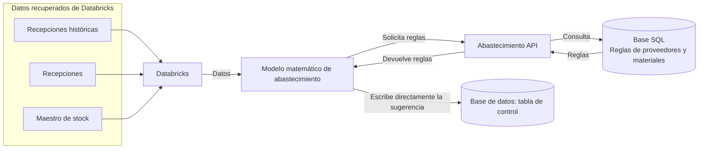
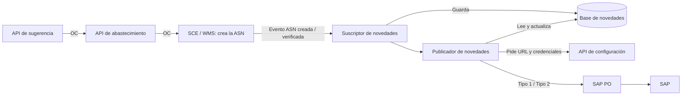

# Abastecimiento · Flujo actual y propuesta

## Etapa 1: generación de orden de compra (flujo actual)

El relevamiento actual alcanza la generación de una **sugerencia de compra en Excel**. Los pasos posteriores hasta la orden de compra todavía están pendientes de documentar.

El notebook de Python está conectado a Databricks para recuperar la información. El modelo matemático se representa como un paso lógico aplicado mediante el notebook, no como un sistema independiente. No se especifican el origen físico de las fuentes ni las fórmulas o el contenido de las reglas.

## Etapa 1: generación de sugerencia (flujo propuesto)

La propuesta mantiene el procesamiento del modelo matemático. En cada ejecución, el modelo solicita a **Abastecimiento API** las reglas de proveedores y materiales; la API las consulta en una base SQL y se las devuelve. El modelo también recupera de Databricks las recepciones históricas, las recepciones y el maestro de stock. Con ambos insumos calcula la sugerencia y **la escribe directamente en la tabla de control de la base de datos**, sin pasar por la API. Este flujo termina con la sugerencia guardada.

Abastecimiento API devuelve la sugerencia de compra; el mecanismo con el que recupera el resultado guardado todavía no está relevado. No se representa una entrega directa del resultado desde el modelo a la API.

La continuación desde la sugerencia guardada hasta la generación de la orden de compra todavía está pendiente de relevar.

## Etapa 2: facturación en SAP

La orden de compra llega a SAP de forma indirecta: la API de sugerencia la envía a la API de abastecimiento, que crea la ASN en SCE/WMS. La integración de almacenes escucha los eventos de la ASN y los publica en SAP a través de SAP PO: alta de la OC (Tipo 1) al crearse la ASN y recepción (Tipo 2) al verificarse.

API de SAP PO (URL, request y validaciones), reglas del publicador y propuesta de envío directo desde la API de sugerencia: [Facturación en SAP](facturacion-sap.md). Detalle de cada bloque: [Componentes de la etapa 2](facturacion-sap-componentes.md).

## Etapa 3: manejo de maestros

Pendiente de relevar y pulir; la propuesta deberá presentarse a gerencia.
