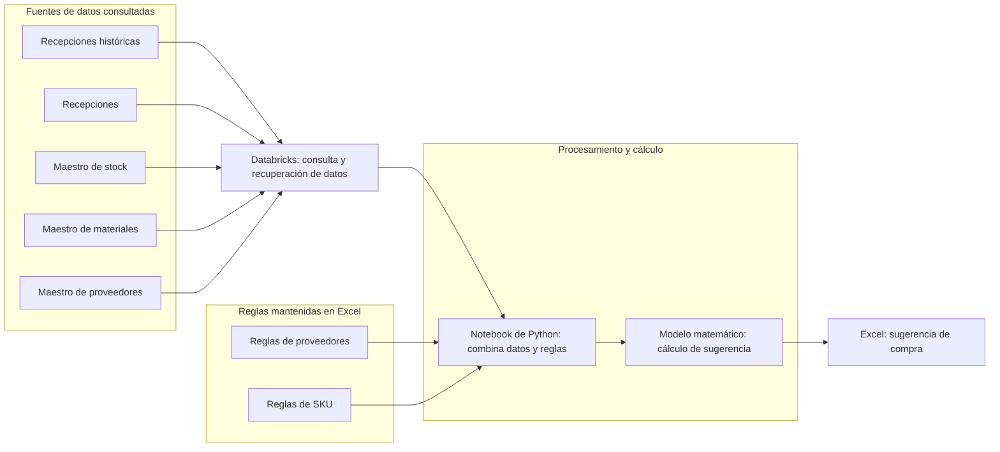
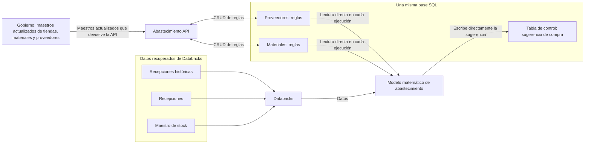
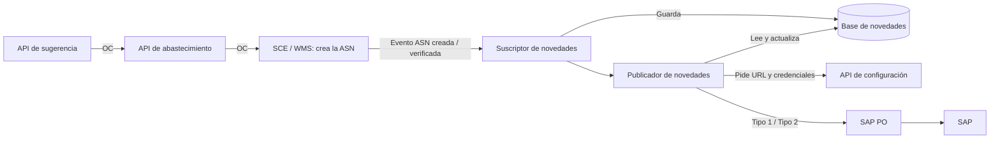

# Abastecimiento · Flujo actual y propuesta

## Etapa 1: generación de orden de compra (flujo actual)

El relevamiento actual alcanza la generación de una **sugerencia de compra en Excel**. Los pasos posteriores hasta la orden de compra todavía están pendientes de documentar.

El notebook de Python está conectado a Databricks para recuperar la información. El modelo matemático se representa como un paso lógico aplicado mediante el notebook, no como un sistema independiente. No se especifican el origen físico de las fuentes ni las fórmulas o el contenido de las reglas.

## Etapa 1: generación de sugerencia (flujo propuesto)

La propuesta mantiene el procesamiento del modelo matemático. En cada ejecución, el modelo **lee directamente de una base SQL** las reglas de proveedores y materiales. También recupera de Databricks las recepciones históricas, las recepciones y el maestro de stock. Combina esos insumos, calcula la sugerencia de compra y **escribe el resultado directamente en la tabla de control de la misma base SQL**.

La base SQL contiene tres entidades importantes: **proveedores**, **materiales** y **tabla de control**. Las dos primeras son entradas del modelo; la tercera guarda la sugerencia calculada. No interviene Abastecimiento API en estas lecturas ni en la escritura. Este flujo termina con la sugerencia guardada.

**Abastecimiento API** permite crear, consultar, modificar y eliminar (CRUD) las reglas de proveedores y materiales de esa base SQL. Además, devuelve los maestros actualizados de **tiendas, materiales y proveedores** desde **Gobierno**. Los maestros de Gobierno y las reglas de negocio en SQL se representan por separado: no se presupone que devolver los maestros implique escribirlos en las entidades de reglas. Los consumidores de estos maestros y el mecanismo de actualización desde Gobierno aún no están detallados.

La continuación propuesta desde la sugerencia guardada se documenta en [Facturación en SAP](facturacion-sap.md#propuesta-envío-directo-desde-la-api-de-sugerencia): generación de OC con materiales asignados al almacén, ASN versionada, envío a SAP y llamada a Abastecimiento API solo después del OK de SAP. La etapa 1 termina con la sugerencia guardada.

## Etapa 2: facturación en SAP

La orden de compra llega a SAP de forma indirecta: la API de sugerencia la envía a la API de abastecimiento, que crea la ASN en SCE/WMS. La integración de almacenes escucha los eventos de la ASN y los publica en SAP a través de SAP PO: alta de la OC (Tipo 1) al crearse la ASN y recepción (Tipo 2) al verificarse.

API de SAP PO (URL, request y validaciones), reglas del publicador y propuesta de envío directo desde la API de sugerencia: [Facturación en SAP](facturacion-sap.md). Detalle de cada bloque: [Componentes de la etapa 2](facturacion-sap-componentes.md).

## Etapa 3: manejo de maestros

Pendiente de relevar y pulir; la propuesta deberá presentarse a gerencia.
