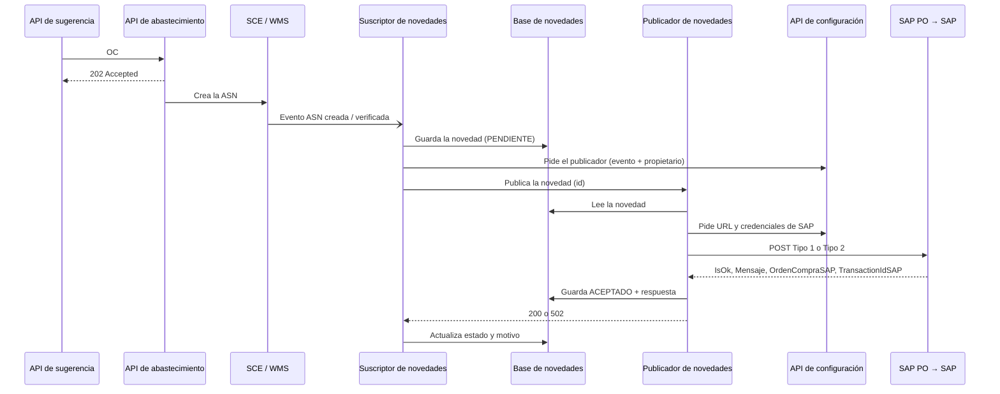
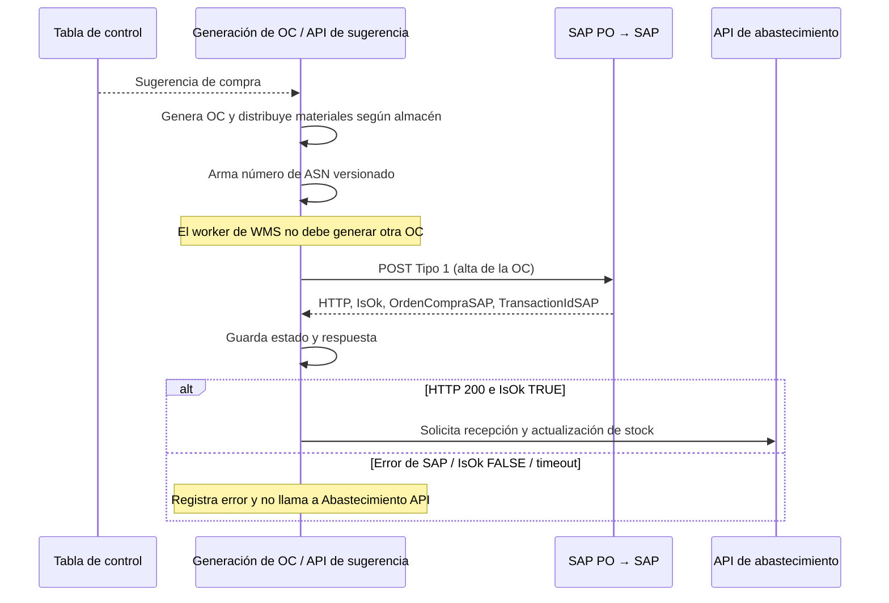

# Etapa 2 · Facturación en SAP

Cómo llega hoy la orden de compra (OC) a SAP, cómo se llama a la API de SAP PO y qué cambia si la API de sugerencia la envía directo. El detalle de cada bloque de los diagramas está en [Componentes](facturacion-sap-componentes.md).

Documento público: la URL de SAP PO aparece con variables y no se incluyen credenciales ni datos de clientes; los valores reales viven en la configuración y en los secretos de cada API.

## Flujo actual

`API de sugerencia → API de abastecimiento → SCE/WMS crea la ASN → evento de ASN → suscriptor → publicador → SAP PO → SAP`

| Evento de la ASN | Mensaje a SAP | Qué registra |
| --- | --- | --- |
| Creada | `Tipo = 1` | Alta de la OC |
| Verificada | `Tipo = 2` | Recepción de la mercadería |



### Qué hace el publicador

1. Lee la novedad que guardó el suscriptor.
2. Arma el mensaje (ver tabla). El `Tipo` sale del evento: creada = 1, verificada = 2.
3. Si la OC es nota de crédito (contrato con prefijo DV), la marca RECHAZADO y no la envía.
4. Si la novedad ya está ACEPTADO, devuelve la respuesta guardada sin reenviar.
5. Pide a la API de configuración la URL y las credenciales de SAP (hasta 3 intentos).
6. Envía el `POST` a SAP PO.
7. Si SAP no responde 2xx, corta y devuelve 502 con el mensaje de SAP.
8. Si responde 2xx, guarda ACEPTADO con `OrdenCompraSAP` y `TransactionIdSAP`. No valida `IsOk`: una respuesta con `IsOk = "FALSE"` también queda ACEPTADO.

## API de SAP PO

Interfaz REST de SAP PO para el alta de la OC (Tipo 1) y la recepción de la mercadería (Tipo 2). Es la que llama hoy el publicador y la que llamaría la API de sugerencia.

### URL y headers

```text
POST http://<host-sap-po>:50000/RESTAdapter/<interfaz-alta-oc>
```

| Parte | Detalle |
| --- | --- |
| `<host-sap-po>` | Host de SAP PO de cada ambiente (desarrollo, QA y producción). Red interna, HTTP, puerto 50000. |
| `<interfaz-alta-oc>` | Interfaz de alta de OC y recepción: la misma en todos los ambientes y para Tipo 1 y Tipo 2. |
| `Authorization` | `Basic` con usuario y contraseña del usuario técnico de SAP PO. Sin token ni OAuth. |
| `Content-Type` | `application/json; charset=utf-8`. El contrato también acepta `text/json` y `text/plain`. |
| `Cookie` | Opcional: cookie de balanceo de SAP PO. |

Los valores reales de cada ambiente no se copian acá. Hoy el publicador los pide a la API de configuración (por propietario + evento) y, si falta alguno, usa su propia configuración:

| Valor | API de configuración | Configuración del publicador |
| --- | --- | --- |
| URL | `Url` | `ExternalApi:SapUrl` |
| Usuario | `ClientId` | `ExternalApi:SapClientId` |
| Contraseña | `ClientSecret` | `ExternalApi:SapClientSecret` |
| Cookie | `UrlToken` | `ExternalApi:SapCookie` |

### Request

Body JSON con nombres en PascalCase. Todos los campos de la tabla son obligatorios salvo `TransactionIdSAP`, y no se admiten campos adicionales.

| Campo | Contrato | Hoy (evento de ASN) | Propuesta (API de sugerencia) |
| --- | --- | --- | --- |
| `Tipo` | texto, 1 car. | Creada `1` · verificada `2` | `1` |
| `Proveedor` | texto, máx. 10 | `asnOriginalEcommerce` | Código SAP del proveedor (validar ceros) |
| `Pedido` | texto, máx. 10 | `recepcionWh` (n° de OC en SCE) | A definir (ver puntos abiertos) |
| `ASN` | texto, máx. 10 | `referenciaProveedor` | Número de ASN versionado; formato y compatibilidad por validar |
| `Fecha` | fecha `YYYY-MM-DD` | Fecha del evento | Fecha de la OC |
| `TransactionIdSAP` | texto, 1 a 10, opcional | No se envía | El recibido, solo en reintentos |
| `Items` | lista | Líneas de la ASN | Líneas de la OC |
| `Items[].Posicion` | entero | Dígitos de `lineaExterna` | N° de línea (1, 2, …) |
| `Items[].Cantidad` | texto con punto decimal | `cantEsperada` (Tipo 1) · `cantRecibida` (Tipo 2) | Cantidad pedida (validar unidad) |
| `Items[].Material` | texto, máx. 18 | `sku` con ceros a la izquierda hasta 18 | Código SAP del material, con el mismo formato |
| `Items[].Centro` | texto, máx. 10 | `codigoCliente` | Centro SAP |
| `Items[].Almacen` | texto, máx. 10 | `almacenConsumo` | Almacén SAP (validar código) |

El contrato también define `MotivoAjuste` (máx. 255) solo para ajustes de stock (Tipo 3 y 4): no se envía en el alta ni en la recepción. Hoy los ítems se agrupan por línea + material sumando cantidades; el Tipo 1 lleva todas las líneas y el Tipo 2, solo las recibidas (cantidad recibida > 0 y esperada = 0).

Ejemplo de alta (Tipo 1) con valores ficticios:

```http
POST http://<host-sap-po>:50000/RESTAdapter/<interfaz-alta-oc>
Authorization: Basic <base64 de usuario:contraseña>
Content-Type: application/json; charset=utf-8

{
  "Tipo": "1",
  "Proveedor": "123456",
  "Pedido": "1000001",
  "ASN": "A1000001",
  "Fecha": "2026-11-10",
  "Items": [
    { "Posicion": 1, "Cantidad": "12", "Material": "000000000000010000", "Centro": "C001", "Almacen": "A001" }
  ]
}
```

En un reintento se agrega `"TransactionIdSAP"` con el valor que devolvió SAP.

### Respuestas

| HTTP | Body | Cómo interpretarla |
| --- | --- | --- |
| `200` | `IsOk`, `Codigo`, `Mensaje`, `OrdenCompraSAP` (n° de OC en SAP) y `TransactionIdSAP` | Éxito solo si `IsOk = "TRUE"`; con `"FALSE"` es un error de SAP aunque el HTTP sea 200. |
| `400` | `IsOk = "FALSE"`, `Codigo` y `Mensaje` | Request inválido. |
| `401` | `IsOk = "FALSE"`, `Codigo` y `Mensaje` | Usuario o contraseña inválidos. |

Ejemplos del contrato:

```json
{ "IsOk": "TRUE", "Codigo": "200", "Mensaje": "", "OrdenCompraSAP": "3241211", "TransactionIdSAP": "00000001" }
```

```json
{ "IsOk": "FALSE", "Codigo": "01", "Mensaje": "Mensaje de Error" }
```

### Validaciones

**Del contrato.** SAP PO declara `400` para un request inválido y `401` para credenciales inválidas.

- Campos obligatorios presentes, con el tipo y el largo de la tabla; `Fecha` en `YYYY-MM-DD`.
- Sin campos adicionales, ni en la cabecera ni en los ítems.
- `TransactionIdSAP` de 1 a 10 caracteres: se omite en el primer envío y nunca va vacío.

**Antes de enviar**, recomendadas en la API de sugerencia:

- Al menos un ítem y `Posicion` única, mayor que 0.
- `Cantidad` con punto decimal y hasta 2 decimales: formato `0.##` con cultura invariante (con `es-AR` saldría coma).
- `Material` con ceros a la izquierda hasta 18, como el publicador. La API de sugerencia hoy lo envía sin ceros al WMS.
- `Fecha` en hora de Argentina: la OC se guarda en UTC y, después de las 21 h, pasaría al día siguiente.
- Controlar los largos y rechazar la OC si un valor no entra, en lugar de truncarlo.
- No reenviar una OC que SAP ya aceptó.

**Al recibir la respuesta:**

- Éxito = 2xx **y** `IsOk = "TRUE"`. El publicador hoy solo mira el HTTP.
- Leer `Codigo` y `OrdenCompraSAP` como texto: pueden llegar como número.
- Guardar `Codigo`, `Mensaje`, `OrdenCompraSAP` y `TransactionIdSAP`.

Las validaciones de negocio de SAP (proveedor, material, centro y almacén existentes, OC duplicada) y sus códigos de error están por confirmar: ver [puntos abiertos](#puntos-abiertos).

## Propuesta: envío directo desde la API de sugerencia

Se toma la **sugerencia de compra guardada en la tabla de control** y se genera una orden de compra que distribuye los materiales según el almacén donde deben gestionarse. Con esa OC se arma un **número de ASN versionado**, que debe permitir que el worker de WMS reconozca estas órdenes y no genere otra OC.

Luego se envía la OC a SAP por SAP PO (Tipo 1). **Solo con HTTP 200 y resultado OK** se llama a **Abastecimiento API para la recepción y actualización de stock**. Según el contrato documentado, un HTTP 200 con `IsOk = "FALSE"` no es OK: no se continúa. Se guarda la respuesta de SAP y, ante error o timeout, no se llama a Abastecimiento API.

El circuito de almacenes (SCE/WMS, eventos de ASN, suscriptor y publicador) sale de esta parte del flujo propuesto. Esto no modifica el [flujo actual](#flujo-actual) ni define cómo se realizará una eventual publicación Tipo 2. El reconocimiento de la ASN versionada por el worker es un requisito de integración, no un mecanismo ya validado.



### Checklist de implementación

- [ ] Cliente HTTP a [SAP PO](#api-de-sap-po): `POST` JSON, Basic auth, `Cookie` opcional y timeout.
- [ ] Configuración por ambiente: URL, usuario, contraseña y cookie (secretos propios o API de configuración) y un flag para habilitar el envío.
- [ ] Tomar la sugerencia de la tabla de control y generar la OC distribuyendo los materiales según el almacén.
- [ ] Generar una ASN versionada y acordar su reconocimiento con el worker de WMS para evitar otra OC.
- [ ] Mapper OC + ASN versionada → request Tipo 1 según la [tabla](#request) y las [validaciones](#validaciones).
- [ ] Para continuar este flujo: HTTP `200` **y** `IsOk = "TRUE"`; cualquier otro caso queda como error con `Codigo` y `Mensaje`.
- [ ] Guardar por OC: estado SAP, `OrdenCompraSAP`, `TransactionIdSAP`, mensaje y fecha.
- [ ] No reenviar OC aceptadas; en reintentos, mandar el `TransactionIdSAP` recibido.
- [ ] Reintento propio (endpoint o job): fuera del circuito de almacenes no hay reintento automático.
- [ ] Llamar a Abastecimiento API para recepción y actualización de stock solo después del OK de SAP.
- [ ] Registrar errores y definir recuperación si SAP acepta la OC pero falla Abastecimiento API.
- [ ] Tests: reparto de materiales, ASN versionada, mapper, validaciones, respuesta OK, `IsOk = "FALSE"`, 400/401, timeout y no invocar Abastecimiento API sin OK de SAP.

### Puntos abiertos

- **Distribución por almacén**: reglas de asignación de materiales y si se genera una OC por almacén o se separan sus líneas.
- **ASN versionada**: formato, longitud, generación de versiones y cómo la reconoce el worker de WMS para no generar otra OC.
- **Pedido**: qué número enviar y cómo correlacionarlo con la OC, la ASN versionada y cualquier recepción posterior.
- **Duplicados**: validar el reconocimiento de la ASN versionada y la idempotencia de los envíos.
- **Cantidad**: la API envía bultos al WMS y el publicador no convierte por caja; confirmar si SAP espera bultos o unidades.
- **Proveedor y ASN**: formato del proveedor y compatibilidad de la ASN versionada con el contrato de SAP PO.
- **Largos**: los ejemplos del contrato para `Proveedor`, `Pedido` y `ASN` tienen 12 caracteres, pero el máximo declarado es 10.
- **Validaciones de SAP**: qué controla SAP (proveedor, material, centro, almacén, OC duplicada) y con qué `Codigo` responde cada caso.
- **Reintento sin respuesta**: si reenviar un envío que quedó sin respuesta (timeout) puede duplicar la OC en SAP.
- **Recepción y stock**: endpoint, request, respuesta y alcance de la operación en Abastecimiento API; no se presupone que reemplace la recepción física ni que se ejecute de forma inmediata.
- **Falla posterior a SAP**: cómo recuperar la recepción / actualización de stock si SAP ya aceptó la OC pero falla Abastecimiento API.
- **Tipo 2**: fuera del alcance de este diagrama; no se mantiene como supuesto el circuito anterior de almacenes.
- **Accesos**: usuario técnico de SAP PO y acceso de red desde la API de sugerencia.
